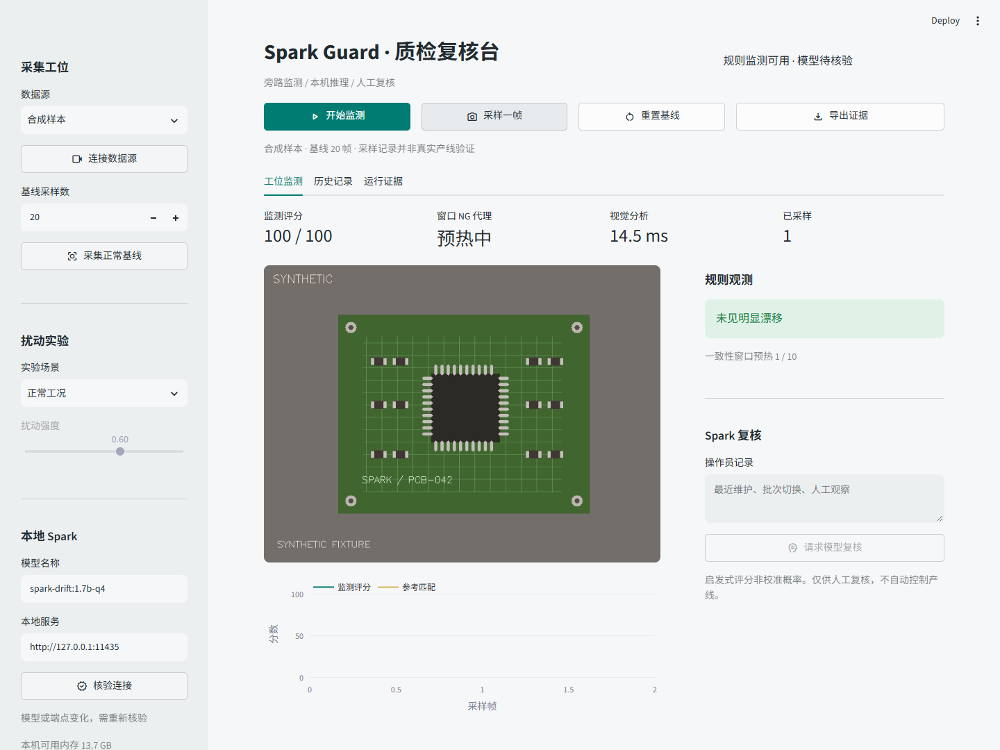
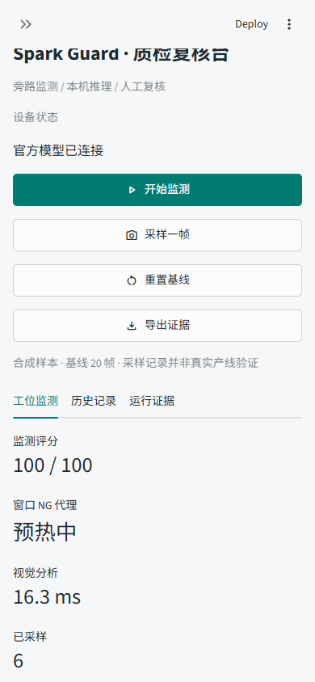
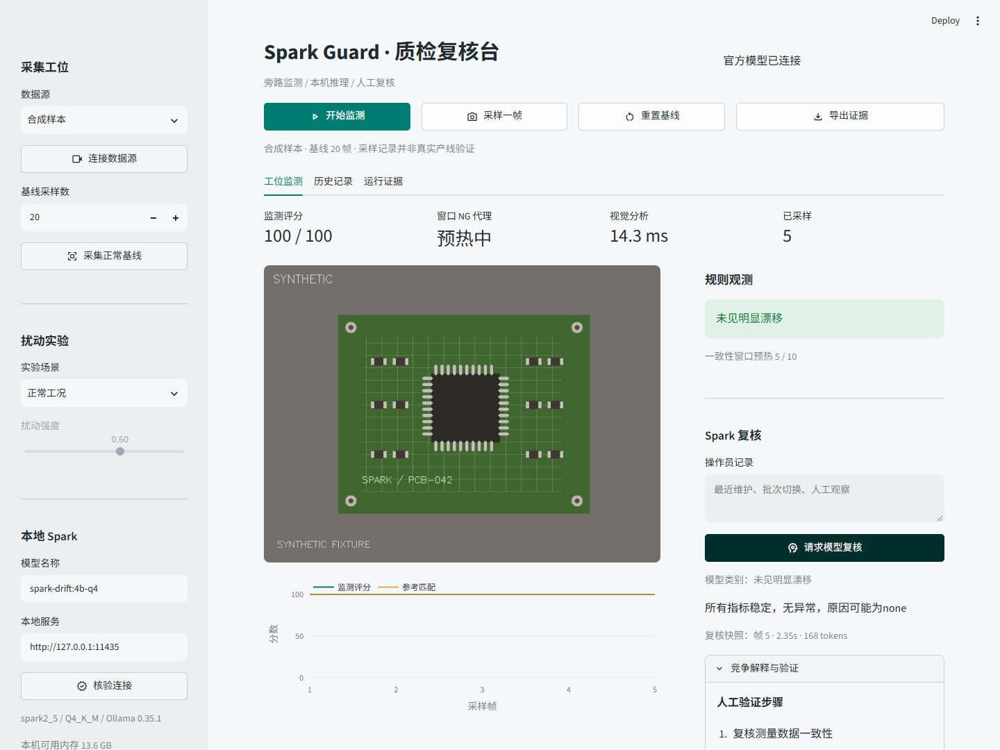
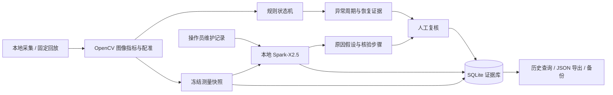
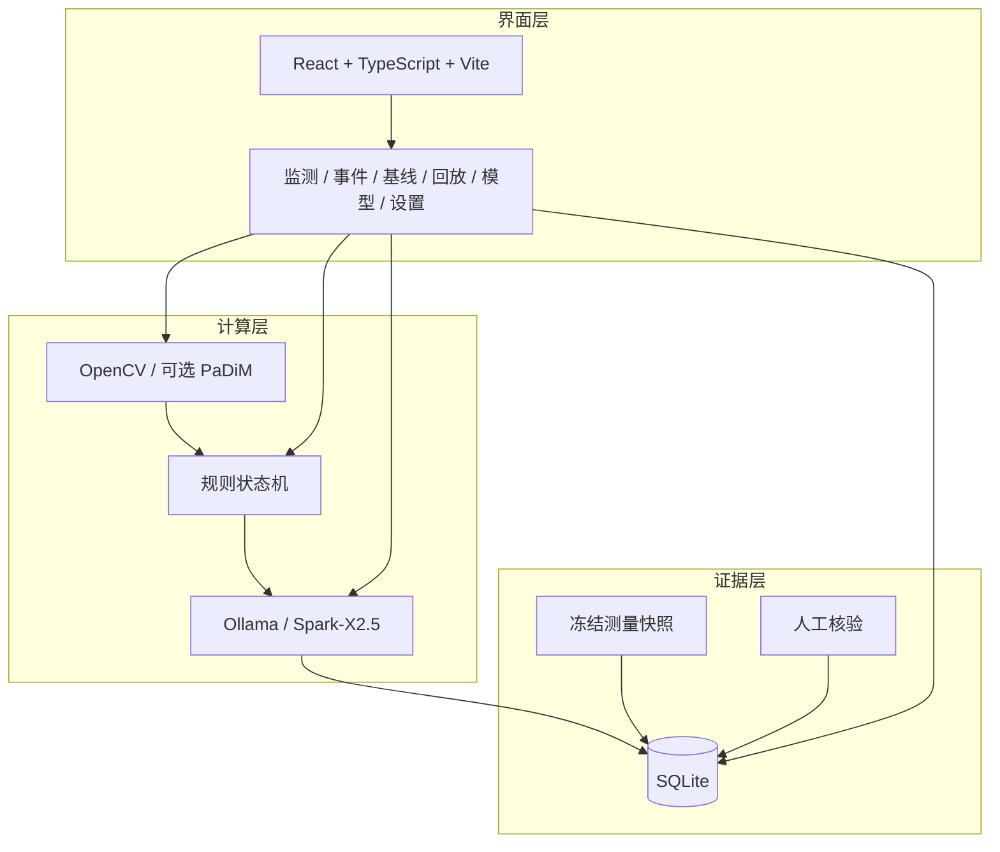

<div align="center">

# SparkGuard

### Industrial vision inspection drift monitoring and local evidence review

面向视觉调试、设备维护和质量工程人员的端侧复核工作台。  
它持续观测成像条件、检测状态与异常周期，结合本地 Spark-X2.5 生成可核验的原因假设，并保留完整证据。

<p>
  <a href="#核心能力">核心能力</a> ·
  <a href="#系统流程">系统流程</a> ·
  <a href="#快速开始">快速开始</a> ·
  <a href="#验证边界">验证边界</a>
</p>

</div>



> 当前版本是可运行的工程原型。默认演示使用合成 PCB 和软件扰动，不代表真实产线验收。项目保留模型错误、证据冲突、失败和未验证事项，不自动执行停线、放行或剔除。

## 项目定位

当质检系统的 NG 数量突然增加时，问题可能来自：

- 镜头失焦、污染、曝光或照明变化
- 相机位置、工装或画面配准变化
- 检测服务缺失、失败、超时或状态不稳定
- 产品或工艺本身发生变化

SparkGuard 放在原有质检器和操作员之间，承担旁路复核职责：

```text
原有质检器
    |
    v
SparkGuard
  观测变化 -> 组织证据 -> 生成竞争性原因假设 -> 提供人工核验步骤
    |
    v
质量人员 / 设备维护人员
```

它不替代原检测器，也不把模型回答当作最终结论。视觉模型负责看图像，Spark 负责阅读结构化文本证据，人工负责最终处置。

## 界面预览

<table>
  <tr>
    <td width="68%">
      
    </td>
    <td width="32%">
      
    </td>
  </tr>
  <tr>
    <td align="center">桌面工作台：监测、基线和事件证据</td>
    <td align="center">移动尺寸：核心信息保持可读</td>
  </tr>
</table>

<p align="center">
  
</p>

## 核心能力

| 模块 | 能力 |
| --- | --- |
| 采集与回放 | 支持合成样本、USB 摄像头、本地视频和固定数据集回放 |
| 图像观测 | 计算清晰度、亮度、对比度、噪声、曝光和画面位移等指标 |
| 基线保护 | 逐帧检查候选基线，质量门失败或保存失败时保留旧版本 |
| 告警周期 | 对持续异常去重，追加新证据，连续完整窗口确认恢复 |
| 上游结果接入 | 导入外部检测结果，保留检测器版本、判定、缺失、失败和超时状态 |
| 视觉异常检测 | 可选 ResNet18 / PaDiM 正常样本建模、阈值标定和独立进程推理 |
| 本地 Spark 复核 | 将测量快照和操作员记录组织成原因假设与区分性验证步骤 |
| 模型管理 | 文件校验、运行时检查、真实推理自检、候选切换、回滚和诊断 |
| 证据留存 | SQLite 历史、事件草稿、分页筛选、完整 JSON 导出和人工结论 |
| 工作空间维护 | 在线快照、受管备份、新目录恢复、归档和空间回收 |
| 复核研究 | 封存题库、同题对照、匿名人工评分和失败分母保留 |

## 系统流程



系统把快路径和慢路径分开：

1. 视觉链路快速计算当前帧和窗口指标。
2. 规则状态机判断异常周期、检测可用性和恢复证据。
3. 事件冻结后，异步提交文本快照给本地 Spark。
4. Spark 只读取白名单测量和操作员记录，不直接读取图像。
5. 原始模型回答、失败、冲突提示和人工结论一起写入证据库。

## 技术架构



### 技术分工

- **React / TypeScript / Vite / Recharts**：本地工作台、趋势图、事件复核和管理页面
- **FastAPI / Uvicorn**：本地 API、静态资源托管和后台采集服务
- **OpenCV / NumPy / SciPy**：图像质量、配准、窗口统计和规则判断
- **ResNet18 / PaDiM**：可选视觉异常检测研发与独立进程接入
- **Ollama / Spark-X2.5**：本地文本证据复核，不直接读取图像
- **SQLite**：保存测量、事件、模型输出、人工结论和版本关系
- **Playwright / pytest**：浏览器流程和后端边界验证

## 项目结构

```text
SparkGuard/
├── frontend/              React 前端源码、依赖锁和构建产物
│   ├── src/               页面与组件
│   ├── public/            静态资源
│   └── dist/              已构建界面
├── src/                   后端、视觉、监测、模型和证据模块
│   ├── api/               FastAPI 应用
│   ├── inspection/        视觉检测和部署
│   ├── llm/               本地模型管理和 Spark 复核
│   └── monitoring/        图像质量和告警状态机
├── scripts/               启动、模型管理、数据准备和验证脚本
├── tests/                 单元测试与边界测试
├── docs/                  功能、部署、数据和验证文档
├── config/                工作台配置
├── models/                模型来源清单和运行配置，不包含权重
├── artifacts/             精选证据、指标记录和截图
├── run.py                 应用入口
└── requirements-lock.txt  Python 依赖锁
```

## 快速开始

### Windows PowerShell

在仓库根目录执行：

```powershell
py -3.12 -m venv .venv
.venv\Scripts\Activate.ps1
python -m pip install -r requirements-lock.txt
npm ci --prefix frontend
npm run build --prefix frontend
python run.py
```

打开终端输出的本机地址，默认是 `http://127.0.0.1:8501`。

### macOS / Linux

```bash
python3.12 -m venv .venv
source .venv/bin/activate
python -m pip install -r requirements-lock.txt
npm ci --prefix frontend
npm run build --prefix frontend
python run.py
```

默认合成演示不需要摄像头或模型。需要本地 Spark 复核时，先在工作台的模型管理页面准备官方模型并执行真实推理自检。

### 本地前端开发

```bash
npm ci --prefix frontend
npm run dev --prefix frontend
```

前端开发服务器只用于界面开发，生产式运行建议使用 FastAPI 同源托管构建产物。

## 验证

```bash
python -m pytest tests -q
npm run build --prefix frontend
npm run format:check --prefix frontend
```

当前仓库保留完整的模型管理、视觉接入、工作空间维护和浏览器验收脚本。公开实验、模型研究和界面证据均在相应文档中标注来源与限制。

## 验证边界

- 默认演示主要使用合成 PCB 和软件扰动，不等同于真实工位验证。
- 模型可能误判；结构化 JSON、内部一致或语言流畅不等同于根因正确。
- 公开数据结果不能替代真实摄像头、真实产品缺陷标签和产线验收。
- 真实用户收益、断网运行、功耗和长期运行仍需单独验证。
- 项目不自动停线、放行、剔除或修改设备阈值。

## 文档入口

- [部署与故障排查](docs/deployment.md)
- [基线与告警可靠性](docs/reliability.md)
- [视觉检测与 PaDiM](docs/visual-detector.md)
- [视觉接入与验证](docs/vision-validation.md)
- [工作空间维护](docs/operations.md)
- [复核研究与人工评分](docs/review-evaluation.md)
- [验证记录与限制](docs/verification.md)
- [第三方组件与原创边界](docs/third_party.md)

## 开源与第三方组件

本项目使用 Spark-X2.5、Ollama、React、FastAPI、OpenCV、PaDiM 相关方法、ResNet18 预训练权重及其他开源组件。具体来源、版本、许可证和数据使用边界见 [docs/third_party.md](docs/third_party.md)。

项目自身许可证尚未单独声明。公开发布前，请根据团队的权属和授权情况补充 `LICENSE` 文件；不要把模型或第三方组件的许可证当作项目代码许可证。

## 项目状态

当前版本：`0.3.0`  
项目类型：可运行工程原型  
整理日期：`2026-10-12`
